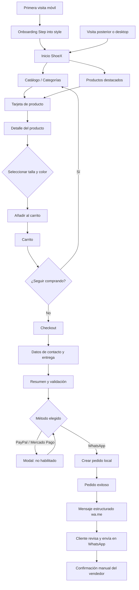
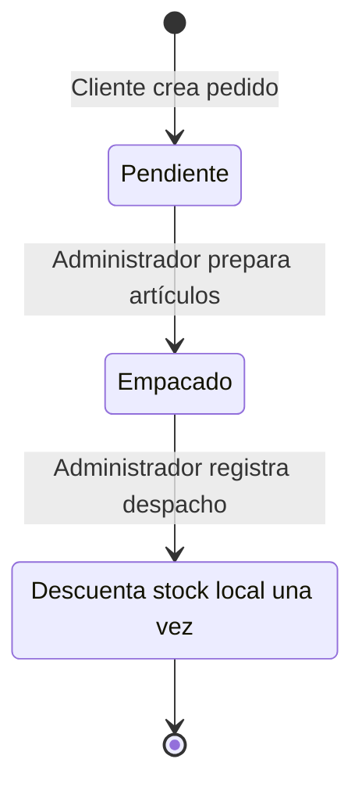
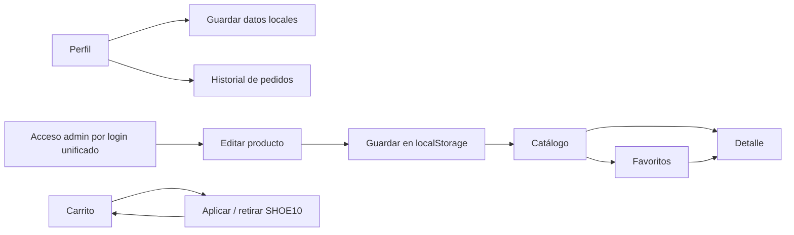
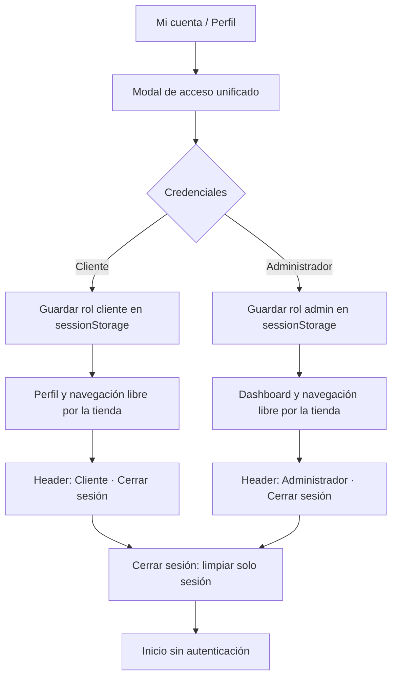

# Flujo de experiencia y compra

## Recorrido principal

## Flujo de preparación y despacho

El administrador consulta el detalle de cada pedido antes de avanzar. El inventario solo se reduce al pasar de Empacado a Procesado y el historial de Perfil refleja el mismo estado.

## Ramas complementarias

## Estados y persistencia

| Estado | Dónde se guarda | Duración / alcance |
|---|---|---|
| Carrito | `localStorage` | En el mismo navegador y origen |
| Favoritos | `localStorage` | En el mismo navegador y origen |
| Perfil | `localStorage` | En el mismo navegador y origen |
| Catálogo editado | `localStorage` | En el mismo navegador y origen |
| Pedidos demo | `localStorage` | Historial local, no compartido con vendedor |
| Último pedido | `sessionStorage` + query string | Contexto de navegación actual; orden completa en localStorage |
| Código promocional | `localStorage` | Hasta retirar cupón, completar pedido o limpiar datos |

## Reglas de interacción

- Cada variante de carrito se identifica por producto + talla + color. La cantidad se valida contra el stock local configurado.
- Las páginas de carrito y checkout recalculan subtotal, descuento, envío y total a partir del estado persistido; no toman el importe de elementos visuales.
- `SHOE10` aplica el porcentaje definido en `assets/js/config.js` sobre el subtotal.
- Al crear la orden se guarda una copia del detalle del producto, sus variantes, totales y datos del comprador; después se vacía el carrito y se elimina el cupón.
- Al crear el pedido, su estado logístico es **Pendiente**. El cliente puede abrir el detalle desde el historial y ver los cambios posteriores.
- El administrador abre el detalle del pedido para consultar los artículos, tallas, colores, cantidades, totales y dirección de entrega.
- La transición permitida es **Pendiente → Empacado → Procesado**. No se permite saltar pasos ni procesar un pedido que no se haya empacado.
- Al cambiar a **Procesado**, el prototipo agrupa las cantidades por referencia, valida stock y descuenta el inventario local una sola vez.
- Si el inventario es insuficiente o ya no existe una referencia, el pedido permanece **Empacado** y el administrador recibe un mensaje.
- El estado actualizado se refleja en el historial local del cliente. No representa un pago o despacho real.
- El mensaje WhatsApp se compone a partir de la orden local, se codifica para URL y no se envía automáticamente.

## Sesión y cierre de sesión

La sesión permanece activa al cambiar de página dentro de la misma pestaña. El cierre de sesión no elimina carrito, favoritos, catálogo local ni pedidos.
